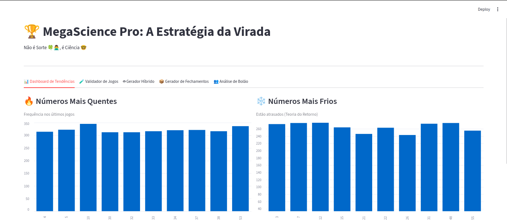
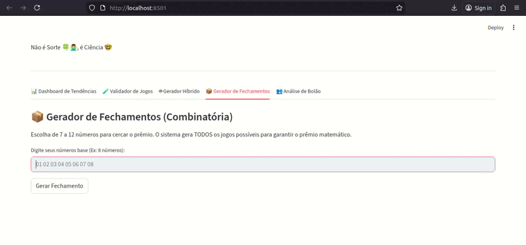
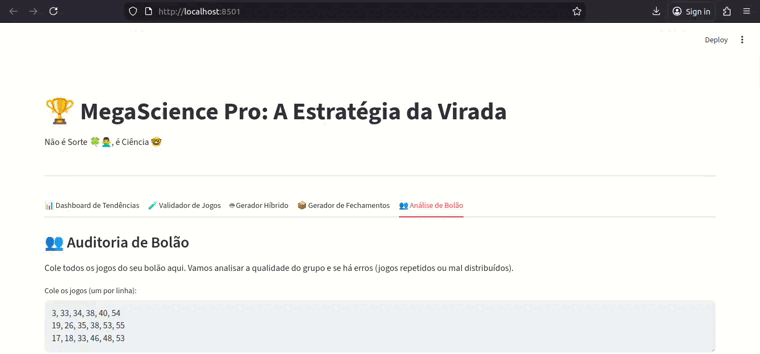

# 🎱 LotoScience Pro

> **Not Luck, It’s Science.** > A statistical engineering tool for analysis, validation, and generation of lottery plays (Mega-Sena).

> ⚠️ The system does not increase the chance of winning; it only improves statistical quality, distribution, and financial efficiency of bets.



---

## About the Project

**LotoScience Pro** is an interactive dashboard built in Python that uses data science to make betting more intelligent. It processes the official Caixa history, applies mathematical filters (Gaussian Curve, Quadrants, Poisson) and generates insights for individual bettors or syndicates.






### Main Features

1.  **📊 Trends Dashboard:** Real-time charts of Hot (frequent) and Cold (overdue) numbers and Poisson analysis (tens endings).
2.  **🧪 Bet Validator:** Enter your numbers and receive a "Score" from 0 to 100 based on the mathematical quality of the bet.
3.  **🤖 Hybrid Generator:** Algorithm combining statistics (Hot/Cold) with controlled randomness to create balanced plays.
4.  **📦 Combinatorics (Wheelings):** Tool to generate all mathematical combinations from a group of numbers (7 to 12 numbers).
5.  **👥 Syndicate Audit:** Paste a list of plays and get a group x-ray (total cost, coverage, duplicate/error detection).

### 🧠 How the Algorithm (Score) Works

The system assigns a score from 0 to 100 for each play based on 4 pillars:

    Gaussian Sum: The sum of the 6 numbers should be between 140 and 240 (where the highest statistical probability occurs).

    Parity: Plays with 3 even and 3 odd numbers (or 4/2) are prioritized. 6/0 plays are penalized.

    Quadrants: The play slip is divided into 4 areas. Plays that leave 2 or more areas empty lose points.

    Anti-Popularity: The system warns (but does not forbid) plays with many sequences or date-like numbers, which tend to split the prize.

---

### System Architecture (ARCHITECTURE.md)

```
┌────────────────────────┐
│        Interface       │
│   (Streamlit Tabs)     │
└──────────▲─────────────┘
           │
┌──────────┴─────────────┐
│     Statistical Engine │
│ validar_jogo()         │
│ gerar_jogo_perfeito()  │
│ verificar_historico()  │
└──────────▲─────────────┘
           │
┌──────────┴─────────────┐
│   Preprocessed Data    │
│ freq / poisson / df    │
└──────────▲─────────────┘
           │
┌──────────┴─────────────┐
│     Data Source        │
│   Historical Excel     │
└────────────────────────┘
```
---

## Installation and Setup

### Prerequisites
* Python 3.10+
* Caixa Excel data file (`data/mega_sena_asloterias_ate_concurso_2954_sorteio.xlsx`)

### Step by Step

1.  **Clone the repository:**
    ```bash
    git clone [https://github.com/your-username/loto-science.git](https://github.com/your-username/loto-science.git)
    cd loto-science
    ```

2.  **Create a virtual environment (Recommended):**
    ```bash
    # Windows
    python -m venv .venv
    .venv\Scripts\activate

    # Linux/Mac
    python3 -m venv .venv
    source .venv/bin/activate
    ```

3.  **Install dependencies:**
    ```bash
    pip install -r requirements.txt
    ```

4.  **Prepare the data:**
    Make sure the Excel file downloaded from Caixa is in the `data/` folder.

5.  **Run the application:**
    ```bash
    streamlit run app.py
    ```

---

## File Structure
```
loto-science/
│
├── data/                                    # Arquivos Excel (histórico)
│   ├── mega_sena_sorteio.xlsx
│   ├── quina_sorteio.xlsx
│   ├── loto_facil_sorteio.xlsx
│   └── loto_mania_sorteio.xlsx
│
├── app/
│   │
│   ├── __init__.py
│   │
│   ├── api/                                 # 🆕 FastAPI (nova camada)
│   │   ├── __init__.py
│   │   ├── main.py                          # App FastAPI + routers
│   │   ├── deps.py                          # Dependency injection (get_service)
│   │   │
│   │   ├── routers/                         # Endpoints por domínio
│   │   │   ├── __init__.py
│   │   │   ├── games.py                     # GET /games, /games/{slug}/config, /context
│   │   │   ├── stats.py                     # GET /games/{slug}/stats/*
│   │   │   ├── generator.py                 # POST /games/{slug}/generate
│   │   │   ├── validator.py                 # POST /games/{slug}/validate
│   │   │   └── closures.py                  # POST /games/{slug}/closures
│   │   │
│   │   └── schemas/                         # 🆕 Modelos Pydantic (DTOs)
│   │       ├── __init__.py
│   │       ├── common.py                    # Tipos reutilizáveis
│   │       ├── games.py                     # GameSummary, GameConfigOut, ContextOut
│   │       ├── stats.py                     # Chi2Out, ICOut, InteligenciaItem, etc
│   │       ├── generator.py                 # GenerateRequest, GenerateResponse
│   │       ├── validator.py                 # ValidateRequest, ValidateResponse
│   │       └── closures.py                  # ClosuresRequest, ClosuresResponse
│   │
│   ├── services/                            # 🆕 Camada de serviços (lógica compartilhada)
│   │   ├── __init__.py
│   │   └── lottery_service.py               # LotteryService (cache + orquestração)
│   │
│   ├── src/                                 # ✅ Core puro (SEM Streamlit)
│   │   ├── __init__.py
│   │   ├── games.py                         # GameConfig, GAMES, BoardLayout (sem mudança)
│   │   ├── data_loader.py                   # 🔄 Ajustado: sem Streamlit, levanta exceções
│   │   ├── statistics.py                    # 🔄 Ajustado: sem @st.cache_data
│   │   ├── generator.py                     # Gerador (sem mudança)
│   │   ├── validator.py                     # 🔄 Ajustado: game_constants movido para src
│   │   ├── advanced_statistics.py           # Estatísticas avançadas (sem mudança)
│   │   ├── constants.py                     # Constantes gerais (sem mudança)
│   │   ├── game_constants.py                # 🔄 Movido de ui/ para src/
│   │   └── logger.py                        # Logger (sem mudança)
│   │
│   └── ui/                                  # ✅ Streamlit (ajustado para usar service)
│       ├── __init__.py
│       │
│       ├── shared.py                        # 🔄 Ajustado: usa LotteryService, retorna (ctx, svc)
│       ├── page_config.py                   # Config de página (sem mudança)
│       ├── styles.py                        # CSS customizado (sem mudança)
│       ├── header.py                        # Header comum (sem mudança)
│       ├── footer.py                        # Footer comum (sem mudança)
│       ├── nav.py                           # Navegação (sem mudança)
│       │
│       ├── dashboard_ui.py                  # 🔄 Ajustado: recebe (ctx, svc)
│       ├── generator_ui.py                  # 🔄 Ajustado: usa svc.generate()
│       ├── validator_ui.py                  # 🔄 Ajustado: usa svc.validate()
│       ├── closures_ui.py                   # 🔄 Ajustado: usa svc.closures()
│       ├── bolao_ui.py                      # 🔄 Ajustado: usa svc.validate()
│       ├── landing_ui.py                    # Landing page (sem mudança)
│       └── board_ui.py                      # Visualização do volante (sem mudança)
│
├── pages/                                   # Páginas Streamlit (ajustes mínimos)
│   ├── 0_Inicio.py                          # 🔄 Ajustado: ctx, svc = load_context()
│   ├── 0_Como_funciona.py                   # (sem mudança)
│   ├── 1_Painel.py                          # 🔄 Ajustado: ctx, svc = load_context()
│   ├── 2_Validador.py                       # 🔄 Ajustado: ctx, svc = load_context()
│   ├── 3_Gerador.py                         # 🔄 Ajustado: ctx, svc = load_context()
│   ├── 4_Fechamentos.py                     # 🔄 Ajustado: ctx, svc = load_context()
│   └── 5_Bolao.py                           # 🔄 Ajustado: ctx, svc = load_context()
│
├── tests/                                   # 🆕 Testes (recomendado adicionar)
│   ├── __init__.py
│   ├── test_generator.py
│   ├── test_validator.py
│   ├── test_statistics.py
│   └── test_api.py
│
├── .env                                     # Variáveis de ambiente (se precisar)
├── .gitignore
├── requirements.txt                         # 🔄 Adicionar: fastapi, uvicorn, pydantic
├── README.md
│
├── run_streamlit.py                         # Script para rodar UI Streamlit
└── run_api.py                               # 🆕 Script para rodar API FastAPI
```

## Statistical Note

All numbers have the same theoretical probability of being drawn.
The analyses presented here are intended only for organization, statistical distribution, and reduction of common patterns—not to predict outcomes.
This software is an analytical tool. It does not guarantee wins. Lottery is gambling and the mathematical probabilities are fixed. Play responsibly.
